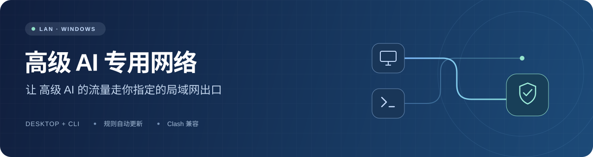
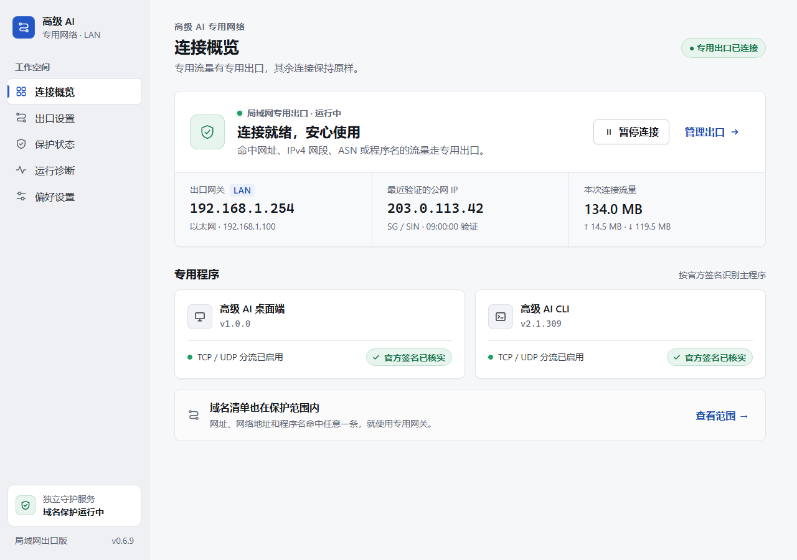
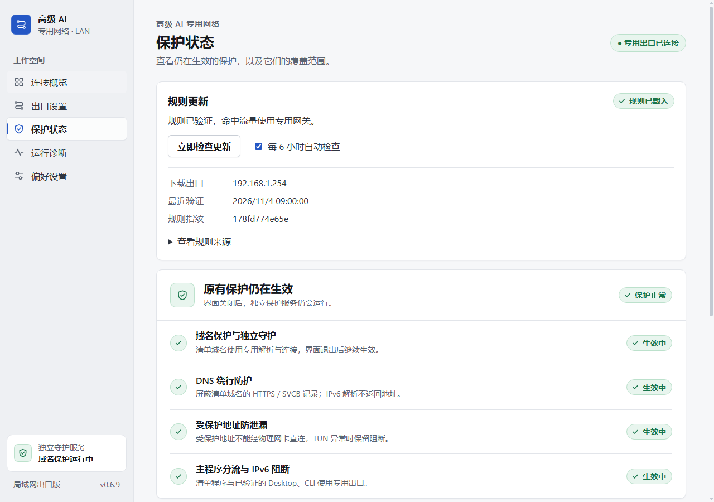
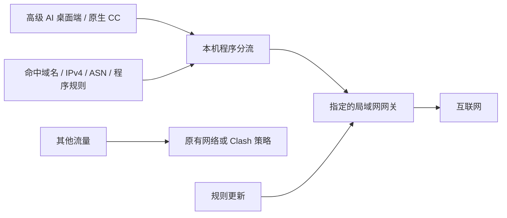

<div align="center">



<p>为 <b>高级 AI 桌面端</b> 与 <b>高级 AI CLI</b> 准备的 Windows 专用网络工具。</p>
<p>选好局域网网关，按程序与规则分流，兼容现有 Clash 系统代理。</p>

[](https://github.com/xuys2025/advanced-ai-network/releases/latest)


[](BUILDING.txt)

**[下载 Windows 安装包](https://github.com/xuys2025/advanced-ai-network/releases/latest/download/AdvancedAINetwork-LAN-Windows-x64.zip)** · **[全部发布文件](https://github.com/xuys2025/advanced-ai-network/releases/latest)** · **[安装步骤](#开始使用)** · **[源码构建](docs/BUILDING.md)**

</div>

---

## 本次更新 · v0.6.9-lan.4

后台退出时，Windows 会阻断受保护程序新建的连接，包括连接本机 Clash。规则中的 IPv4 网段和 ASN 公告网段也受持久阻断保护。后台重新验证转发路径和域名守护后才会恢复放行。

独立托盘提醒会复核短暂的状态文件占用。确认服务停止会立即提醒，公网 IP 变化只提醒。桌面快捷方式可检查当前网关的实际 HTTPS 出口，也可以手动紧急暂停。

已有公开版用户请先保存工作并退出桌面端与 CLI，再解压新版、运行 `Install.cmd`，填写原网关和 Clash 端口。升级会重启相关服务。 [本版下载与校验值](https://github.com/xuys2025/advanced-ai-network/releases/tag/v0.6.9-lan.4)

## 先确认你的网络环境

你需要一台**与电脑处于同一子网、能够访问 高级 AI 的 IPv4 网关**。在软件里填写它的局域网地址，例如 `192.168.1.254`，流量就可以经它出站。实际网络线路由这台网关提供。

当前版本面向 **Windows 10 / 11 x64、有线以太网、原生桌面程序**。请先自行安装 Npcap，再安装本工具。用户侧需要遵守 Npcap 的现行许可。 [Npcap 官网](https://npcap.com/) · [Npcap 许可与分发说明](https://npcap.com/oem/redist)

## 看得见的连接与保护



<p align="center"><sub>当前界面的离线演示，IP、网关、版本信息与流量使用示例数据。</sub></p>

| 功能 | 使用方式 |
| --- | --- |
| Desktop + CLI | 识别官方桌面端、原生 CC CLI，以及桌面端缓存目录中的内置 CC。 |
| 可自定义出口 | 填入网关，先验证公网出口，再保存使用。 |
| 按规则分流 | 域名、域名后缀、关键词、IPv4 网段、ASN 与程序名，命中任意一类即走专用出口。 |
| 规则自动更新 | 每 6 小时检查一次，也可以在界面手动更新；通过所选网关拉取规则和 ASN 数据。 |
| Clash 兼容 | 用合并脚本添加专用出口与规则提供器，保留已有策略。 |
| 独立保护后台 | 域名解析与受保护地址由独立服务维护，托盘界面可以单独关闭。 |
| 日常使用 | 登录自启动、启动隐藏、关闭到托盘，以及运行状态和错误计数。 |

<details>
<summary><b>查看规则与保护页面</b></summary>



</details>

## 开始使用

1. 下载 **Windows 安装包**，完整解压到本地目录。包内包含应用运行时和项目源码。
2. 从 Npcap 官网安装 Npcap。打包验证时使用了 Npcap 1.90。
3. 保存工作并完全退出 高级 AI 桌面端、CC CLI。
4. 双击 `Install.cmd`，在当前 Windows 用户下批准管理员授权。
5. 填写自己的网关，选择以太网网卡。程序路径会自动识别，找不到时可手动填写。Clash 端口应填实际的 HTTP / 混合端口。
6. 打开桌面的「高级 AI 专用网络」，进入「出口设置」验证出口，确认公网 IP 与地区。
7. 如果启用了 Clash 系统代理，按下一节合并脚本，再自行启动 Desktop 与 CC CLI 验证联网。

安装会创建独立后台服务、域名 DNS 策略和受保护地址的本机 TUN。为了覆盖任意关键词匹配，系统 DNS 查询先经过本机守护，普通域名交给网卡原有 DNS。请在首次安装后同时验证 高级 AI 和日常网站。

此公开版使用新的后台名称。装有旧名称版本的电脑会被安装器拦下，避免两套后台争用端口；迁移需要另行安排，已有保护会保留。

### 与 Clash 一起使用

先把现有全局扩展脚本保存为 `original.js`，再在解压目录运行以下命令。

```powershell
powershell -NoProfile -ExecutionPolicy Bypass -File .\Merge-Clash.ps1 -Original .\original.js
```

把生成的 `Clash-Merged.js` 完整粘贴到 Clash 全局扩展脚本，重新应用订阅，使用**规则模式**。没有原脚本时可省略 `-Original`。

合并脚本会连接本机规则提供器 `127.0.0.1:17894`，让命中规则的流量进入专用出口。已有代理、策略组和其他规则会保留。请保存原脚本，恢复网络时会用到。

### 检查与更换网关

```powershell
# 校验解压文件的 SHA-256
powershell -NoProfile -ExecutionPolicy Bypass -File .\Verify-Package.ps1

# 检查后台、域名保护与出口，生成本机诊断报告
powershell -NoProfile -ExecutionPolicy Bypass -File .\Check.ps1
```

更换出口时，在「出口设置」填写新网关，点击「验证出口」，确认结果后「保存并使用」。验证结果有效 5 分钟，应用新出口时相关连接可能重连。更换网卡需要退出目标程序后重新运行安装器。

## 规则从哪里来

规则源为 VPSDance 的 高级公司 规则集。程序解析域名、后缀、关键词、IPv4 CIDR、ASN 和程序名；ASN 的 IPv4 前缀由 RIPEstat 查询。两类请求都通过当前专用网关发送。更新失败时保留上一份有效规则，界面显示检查结果。 [高级公司 规则集](https://github.com/VPSDance/ai-proxy-rules) · [RIPEstat](https://stat.ripe.net/)

下面是当前架构中的主要路径。



域名保护使用本机选择性 TUN、DNS 和阻断规则。应用上游连接通过 Npcap 发往指定以太网下一跳；程序的主流量识别使用 WinDivert。 [详细架构](ARCHITECTURE.txt)

## 下载与自行修改

| 下载项 | 适合谁 |
| --- | --- |
| [AdvancedAINetwork-LAN-Windows-x64.zip](https://github.com/xuys2025/advanced-ai-network/releases/latest/download/AdvancedAINetwork-LAN-Windows-x64.zip) | 直接使用，包含应用、安装器与项目源码。 |
| [AdvancedAINetwork-ThirdParty-Sources.zip](https://github.com/xuys2025/advanced-ai-network/releases/latest/download/AdvancedAINetwork-ThirdParty-Sources.zip) | 需要审阅或重编第三方核心，包含对应源码与精确依赖归档。 |
| [SHA256SUMS.txt](https://github.com/xuys2025/advanced-ai-network/releases/latest/download/SHA256SUMS.txt) | 核对下载文件的完整性。 |

修改界面和 C# 代码可以直接从安装包中的 `Sources` 开始。完整步骤、原生组件编译和目录说明见构建文档。 [构建与维护](docs/BUILDING.md)

```text
Sources/
├── client/        Electron 界面、预加载、IPC 与窗口偏好
├── gateway/       网关代理、程序识别、规则更新与诊断
├── native/        原生桥接、UDP 归属与签名校验
├── guard/         域名 DNS 与本机 TUN 守护
├── launcher/      启动器与窗口恢复
└── third_party/   ProxyBridge 源码与 WinDivert SDK
```

## 当前支持边界

- 当前发布仅面向 IPv4。IPv6 已关闭的环境是本次验证范围。
- 网关应与当前有线网卡处于同一子网。Wi-Fi、WSL、虚拟机、npm 版 CLI 与 Clash TUN 模式需要单独适配和验证。
- 官方 Desktop / CLI 使用签名识别；规则集中的程序名按规则匹配。Git、Python、MCP 子进程是否走专用出口，由其自身是否命中规则决定。
- 应用自行使用 DoH、缓存旧公网地址等路径，可能绕开系统域名解析。首次使用前请关闭相关应用的安全 DNS，并重新建立连接。
- 转发后台停用时，Windows 会继续阻断受保护程序和规则网段。清单域名由独立 DNS 守护和本机 TUN 保护。
- 已在开发机验证 Desktop、原生 CLI、规则更新、出口与保护流程；尚未完成第二台全新 Windows 的完整安装验收。
- 长上下文的上传速度和旧连接重置仍在排查。此发布保留现有行为，问题反馈请附发送时间、版本和脱敏后的错误摘要。

## 停用与恢复

先退出 高级 AI 程序，并恢复之前备份的 Clash 原脚本。在当前用户的管理员 PowerShell 中，从安装包目录运行以下命令，按提示输入 `RESTORE`。

```powershell
powershell -NoProfile -ExecutionPolicy Bypass -File .\Uninstall.ps1 -RestoreNetwork
```

这会解除本工具建立的域名策略、WFP 阻断和配套防火墙规则。省略 `-RestoreNetwork` 会保留域名、程序与网段保护。程序和配置文件会保留，便于恢复和排查。

## 许可与致谢

项目源码随包提供，供研究、使用和自行修改，采用现有的源码分享说明。各第三方组件继续遵守其自身许可。 [源码分享说明](SOURCE-NOTICE.txt) · [第三方组件](THIRD-PARTY-NOTICES.txt)

感谢 Electron、WinDivert、ProxyBridge、sing-box、Npcap 与 VPSDance 规则集。Npcap 由使用者独立安装。本项目由社区维护，与 高级公司 官方无隶属关系。
